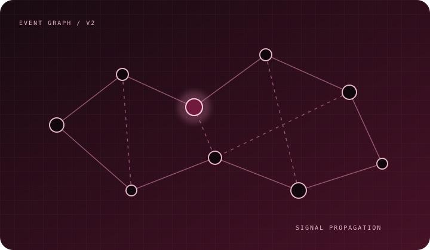
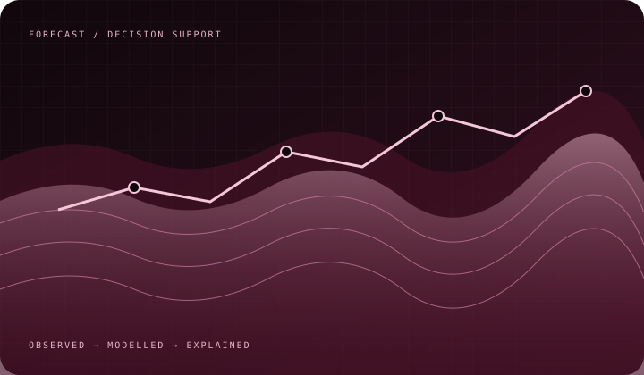

**Full-Stack Developer · Backend Engineering · AI Systems**

[Portfolio](https://iuttkarshh0409.github.io/) · [GitHub](https://github.com/iuttkarshh0409) · [LinkedIn](https://www.linkedin.com/in/utkarsh-dubey-227098352/) · [Writing](https://medium.com/@dubeutkarsh7)

## The engineering mindset

I build practical software where reliable engineering meets intelligent decision-making. My interests span full-stack applications, backend architecture, developer tooling, and explainable AI.

- **Building:** reliability-oriented systems and full-stack products.
- **Exploring:** system design, APIs, observability, and explainable AI.
- **Method:** understand the problem, design the system, test assumptions, iterate.

## Selected work

<table>
<tr><td width="50%" valign="top">

### AERIS V2
**Deterministic Reliability Intelligence Engine**

Turns failure events into structured reliability signals to help identify patterns and systemic risks.

`Python` `FastAPI` `SQLite` `REST APIs`

[Repository ↗](https://github.com/iuttkarshh0409/aeris-v2)

</td><td width="50%" valign="top">

### AquaSentinel
**Groundwater Forecasting & Decision Support**

An AI-oriented platform concept for groundwater prediction, data exploration, and explainable recommendations.

`Python` `FastAPI` `scikit-learn` `React`

[Repository ↗](https://github.com/iuttkarshh0409/aquasentinel-indore)

</td></tr>
</table>

### More projects

- **AlumConnect:** multi-tenant alumni networking and mentorship platform using React, FastAPI, and MongoDB.
- **Habit Tracker:** personal analytics dashboard using Streamlit, SQLite, and Plotly. [Live app ↗](https://habit-tracker-utkarsh.streamlit.app/)

## Technology

## Live GitHub activity

Third-party activity cards can be rate-limited. Language distribution is not a measure of proficiency.

## Writing

- [Should Alumni Databases Show Reported or Current Employers?](https://medium.com/@dubeutkarsh7/should-alumni-databases-show-reported-or-current-employers-a-data-dilemma-3b0eaf430e5d)
- [Building an Operational Drift Analyser](https://medium.com/@dubeutkarsh7/building-an-operational-drift-analyzer-2d256f78c549)
- [The Batch Year Dilemma](https://medium.com/@dubeutkarsh7/the-batch-year-dilemma-how-to-record-alumni-who-exit-early-from-integrated-programs-321b744c6552)

Build with intention. Test the assumptions. Improve the system.

