 

**Building practical software at the intersection of reliable engineering and intelligent systems.**

[GitHub](https://github.com/iuttkarshh0409) · [LinkedIn](https://www.linkedin.com/in/utkarsh-dubey-227098352/) · [Portfolio](https://swayam-sanchay.vercel.app/) · [Medium](https://medium.com/@dubeutkarsh7)

---

## About

I'm a software developer interested in building useful products, dependable backend systems, and explainable AI-driven tools. I enjoy taking a problem from its first rough idea through architecture, implementation, testing, and deployment.

- 🔭 **Building:** AERIS V2, a deterministic reliability intelligence engine, and practical full-stack applications.
- 🧠 **Exploring:** backend engineering, system design, data science, and explainable AI.
- 🧰 **Approach:** document the design, build iteratively, test assumptions, and keep the system understandable.
- 🤝 **Open to:** thoughtful open-source collaboration and research-driven software projects.

## Selected Projects

<table>
<tr>
<td width="50%" valign="top">

### 🛡️ AERIS V2
**Deterministic reliability intelligence**

Transforms failure events into structured reliability signals to help engineers identify patterns and systemic risks rather than reacting to isolated incidents.

**Stack:** Python · FastAPI · SQLite · REST APIs

[Explore repository →](https://github.com/iuttkarshh0409/aeris-v2)

</td>
<td width="50%" valign="top">

### 🌊 AquaSentinel
**Groundwater forecasting and decision support**

An AI-oriented groundwater forecasting concept combining predictive analysis, visual exploration, and explainable recommendations for sustainable water management.

**Stack:** Python · FastAPI · scikit-learn · React · Pandas · NumPy

[Explore repository →](https://github.com/iuttkarshh0409/aquasentinel-indore)

</td>
</tr>
<tr>
<td width="50%" valign="top">

### 🎓 AlumConnect
**Alumni networking and mentorship**

A multi-tenant platform concept connecting students and alumni through profiles, mentorship workflows, messaging, and analytics.

**Stack:** React · FastAPI · MongoDB

</td>
<td width="50%" valign="top">

### 📈 Habit Tracker
**Personal analytics dashboard**

A habit-tracking application with a dashboard for exploring personal progress and patterns over time.

**Stack:** Python · Streamlit · SQLite · Plotly

[Open live app →](https://habit-tracker-utkarsh.streamlit.app/)

</td>
</tr>
</table>

## Technology Stack

**Languages**

**Frontend and backend**

**Data and tooling**

## GitHub Activity

Statistics and third-party visualizations depend on external services and may occasionally be unavailable. Language charts represent repository composition, not a direct measure of proficiency.

## Writing

- [Should Alumni Databases Show Reported or Current Employers? A Data Dilemma](https://medium.com/@dubeutkarsh7/should-alumni-databases-show-reported-or-current-employers-a-data-dilemma-3b0eaf430e5d)
- [Building an Operational Drift Analyser](https://medium.com/@dubeutkarsh7/building-an-operational-drift-analyzer-2d256f78c549)
- [The Batch Year Dilemma: How to Record Alumni Who Exit Early from Integrated Programs](https://medium.com/@dubeutkarsh7/the-batch-year-dilemma-how-to-record-alumni-who-exit-early-from-integrated-programs-321b744c6552)

## Connect

I'm interested in conversations about practical software engineering, backend architecture, developer tooling, data-driven applications, and explainable AI.

 

Build with intention. Test the assumptions. Improve the system.

