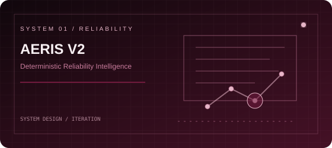
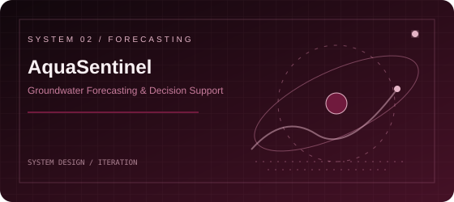

<div align="center">



<br/>

[](https://github.com/iuttkarshh0409)
[](https://www.linkedin.com/in/utkarsh-dubey-227098352/)
[](https://medium.com/@dubeutkarsh7)

</div>



## 01 / The person behind the commits

I build software where **reliable engineering meets intelligent decision-making**. My interests span full-stack applications, backend architecture, developer tooling, and explainable AI.

```text
CURRENT MODE   →   Design clearly. Build iteratively. Verify honestly.
INTERESTS      →   Backend systems / Full-stack products / Data & AI
ENGINEERING    →   Understand the failure mode, not just the happy path.
```

- 🛡️ Building reliability-oriented systems and practical software products.
- 🌊 Exploring explainable forecasting and data-driven decision support.
- 🧩 Interested in system design, APIs, observability, and developer experience.
- ✍️ Writing about real engineering and data-modeling decisions.


## 02 / Selected systems

<table>
<tr>
<td width="50%" valign="top">

<a href="https://github.com/iuttkarshh0409/aeris-v2"></a>

### AERIS V2
**Deterministic Reliability Intelligence Engine**

Turns failure events into structured reliability signals to help identify patterns and systemic risks rather than reacting to isolated incidents.

`Python` `FastAPI` `SQLite` `REST APIs`

[Inspect the repository ↗](https://github.com/iuttkarshh0409/aeris-v2)

</td>
<td width="50%" valign="top">

<a href="https://github.com/iuttkarshh0409/aquasentinel-indore"></a>

### AquaSentinel
**Groundwater Forecasting & Decision Support**

An AI-oriented platform concept combining groundwater prediction, data exploration, and explainable recommendations for sustainable water management.

`Python` `FastAPI` `scikit-learn` `React`

[Inspect the repository ↗](https://github.com/iuttkarshh0409/aquasentinel-indore)

</td>
</tr>
<tr>
<td width="50%" valign="top">

### AlumConnect
**Alumni networking and mentorship**

A multi-tenant platform concept connecting students and alumni through profiles, mentorship workflows, messaging, and analytics.

`React` `FastAPI` `MongoDB`

</td>
<td width="50%" valign="top">

### Habit Tracker
**Personal analytics dashboard**

A habit-tracking app with interactive visualizations for exploring progress and patterns over time.

`Python` `Streamlit` `SQLite` `Plotly`

[Open live app ↗](https://habit-tracker-utkarsh.streamlit.app/)

</td>
</tr>
</table>


## 03 / The toolkit

<div align="center">

**LANGUAGES**


**FRONTEND / BACKEND**


**DATA / TOOLS**


</div>


## 04 / Live telemetry

<div align="center">


</div>

<sub>These cards depend on third-party services and may be rate-limited or unavailable. Language distribution is not a measure of skill. No synthetic contribution counts or streaks are displayed.</sub>


## 05 / Notes from the engineering desk

- [Should Alumni Databases Show Reported or Current Employers? A Data Dilemma](https://medium.com/@dubeutkarsh7/should-alumni-databases-show-reported-or-current-employers-a-data-dilemma-3b0eaf430e5d)
- [Building an Operational Drift Analyser](https://medium.com/@dubeutkarsh7/building-an-operational-drift-analyzer-2d256f78c549)
- [The Batch Year Dilemma: How to Record Alumni Who Exit Early from Integrated Programs](https://medium.com/@dubeutkarsh7/the-batch-year-dilemma-how-to-record-alumni-who-exit-early-from-integrated-programs-321b744c6552)

## 06 / Open channel

I enjoy conversations about backend architecture, system reliability, developer tooling, data-driven applications, and explainable AI.

<div align="center">

[](https://github.com/iuttkarshh0409)
[](https://www.linkedin.com/in/utkarsh-dubey-227098352/)



</div>
